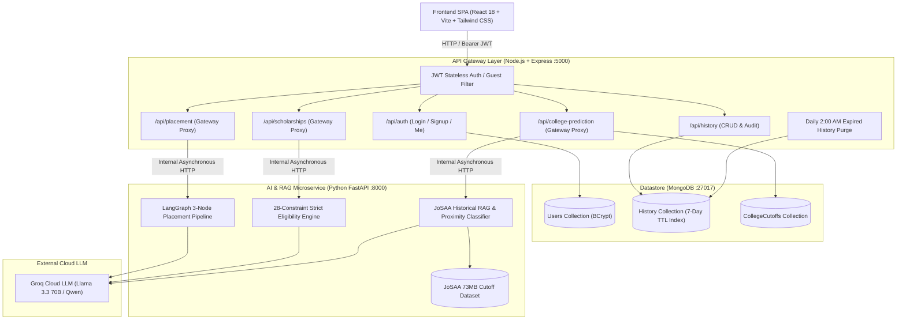

# 🚀 OneStop — AI-Powered Student Career & Academic Navigator

<p align="center">
  
  
  
  
  
  
  
  
</p>

---

## 📌 Table of Contents
- [Overview](#-overview)
- [System Architecture](#-system-architecture)
- [Core Features](#-core-features)
  - [1. AI Placement Preparation Engine (LangGraph)](#1-ai-placement-preparation-engine-langgraph)
  - [2. Smart Scholarship Discovery Finder (28 Strict Rules)](#2-smart-scholarship-discovery-finder-strict-rules)
  - [3. JoSAA College Cutoff Predictor (RAG Engine)](#3-josaa-college-cutoff-predictor-rag-engine)
  - [4. Enterprise Authentication & Security](#4-enterprise-authentication--security)
  - [5. Automated 7-Day TTL History Purge](#5-automated-7-day-ttl-history-purge)
- [REST API Reference](#-rest-api-reference)
- [Project Directory Structure](#-project-directory-structure)
- [Getting Started & Local Setup](#-getting-started--local-setup)
  - [Option 1: 1-Command Docker Compose (Recommended)](#option-1-1-command-docker-compose-recommended)
  - [Option 2: Local Step-by-Step Execution](#option-2-local-step-by-step-execution)
- [Environment Variables Guide](#-environment-variables-guide)
- [Contributing & License](#-contributing--license)

---

## 🌟 Overview

**OneStop** is a unified, intelligent web platform engineered to eliminate information asymmetry for college students and aspirants. It combines **React 18**, **Node.js Express**, **Python FastAPI**, **MongoDB**, **Groq Cloud LLM**, and **LangGraph / RAG** to deliver three core pillars of student success:

1. **AI Placement Preparation**: Personalized day-by-day technical study roadmaps, company hiring round blueprints, and verified interview questions curated through a multi-node LangGraph agentic workflow.
2. **Scholarship Discovery Finder**: Strict eligibility matching across national, state, and corporate schemes with 28 zero-hallucination verification constraints.
3. **JoSAA College Predictor (RAG)**: Real-time admission feasibility forecasting utilizing a 73MB historical JoSAA cutoff dataset with mathematical categorization into **Safe**, **Target**, and **Ambitious** tiers.

---

## 🏛️ System Architecture

OneStop is built on a **Polyglot Microservices Pattern**, decoupling fast API routing & authentication from compute-heavy AI/ML workflows:



---

## 🌟 Core Features

### 1. AI Placement Preparation Engine (LangGraph)
- **Multi-Node StateGraph Workflow**:
  - *Node 1 (Analyze):* Analyzes company technical profile, DSA vs System Design weightage, and hiring rounds.
  - *Node 2 (Curate):* Curates exactly 10–15 verified technical interview questions with model answers.
  - *Node 3 (Roadmap):* Divides available time (e.g. 15, 30, 45 days) into logical day intervals with specific preparation tasks.
- **Strict Pydantic Validation**: Guarantees zero malformed JSON responses.

### 2. Smart Scholarship Discovery Finder (Strict Rules)
- **28 Zero-Hallucination Guardrails**: Checks State Domicile, Caste Category, Income Ceiling, Academic Discipline, Gender, and PwD status.
- **Match Score (0–100%)**: Evaluates candidate profile alignment.
- **Status Classification**: Only outputs `Eligible`, `Potentially Eligible`, or `Additional Verification Required`.
- **Verified Schemes**: Direct application links to National Scholarship Portal (NSP) and State portals.

### 3. JoSAA College Cutoff Predictor (RAG Engine)
- **73MB JoSAA Dataset RAG**: Indexes multi-year cutoffs for IITs, NITs, IIITs, and GFTIs.
- **Mathematical Categorization**:
  - 🟢 **Safe**: Student rank is better than opening rank (`rank < opening_rank`).
  - 🔵 **Target**: Student rank falls within range (`opening_rank <= rank <= closing_rank`).
  - 🔴 **Ambitious**: High dream option (`rank > closing_rank`).
- **Target College Check**: Real-time feasibility diagnosis for dream institutes.
- **Augmented Counseling Strategy**: LLM generates choice-filling advice based strictly on retrieved data.

### 4. Enterprise Authentication & Security
- **Stateless JWT Tokens**: Signed with HMAC SHA-256 and stored securely in `localStorage`.
- **Dual-Mode Filtering**:
  - *Guest Users:* Full access to Placement, Scholarship, and College prediction engines.
  - *Authenticated Users:* Activity automatically logged to their private History vault.
- **BCrypt Password Hashing**: 10 salt rounds with automated pre-save Mongoose middleware.

### 5. Automated 7-Day TTL History Purge
- Activity history automatically expires after 7 days.
- Uses MongoDB native **TTL (Time-To-Live) index** (`expireAfterSeconds: 0`) + daily scheduled **node-cron** worker at 2:00 AM.

---

## 📡 REST API Reference

### 1. Authentication (`/api/auth`)
| Method | Endpoint | Access | Description |
|---|---|---|---|
| `POST` | `/api/auth/signup` | Public | Register new user account |
| `POST` | `/api/auth/login` | Public | Authenticate user credentials & get JWT token |
| `GET` | `/api/auth/me` | Private | Retrieve logged-in user profile |

### 2. Placement Engine (`/api/placement`)
| Method | Endpoint | Access | Description |
|---|---|---|---|
| `POST` | `/api/placement/generate` | Public / Auth | Generate day-wise roadmap & questions via LangGraph |

### 3. Scholarship Finder (`/api/scholarships`)
| Method | Endpoint | Access | Description |
|---|---|---|---|
| `POST` | `/api/scholarships/find` | Public / Auth | Match eligible schemes with 28 strict verification rules |

### 4. College Predictor & RAG (`/api/college-prediction`, `/api/college-cutoffs`)
| Method | Endpoint | Access | Description |
|---|---|---|---|
| `POST` | `/api/college-prediction/predict` | Public / Auth | Predict eligible colleges with RAG + JoSAA cutoffs |
| `POST` | `/api/college-cutoffs/import/josaa` | Public / Admin | Stream & ingest JoSAA CSV cutoffs into MongoDB |

### 5. Activity History (`/api/history`)
| Method | Endpoint | Access | Description |
|---|---|---|---|
| `GET` | `/api/history` | Private | Fetch active user history (newest first) |
| `DELETE` | `/api/history/:id` | Private | Delete specific history record owned by user |

---

## 📂 Project Directory Structure

```plaintext
OneStop/
├── docker-compose.yml                     # Multi-container orchestration
├── .env.example                           # Root environment template
├── start.bat                              # One-click Windows multi-service launcher
├── README.md                              # Full architectural documentation
│
├── backend/                               # Node.js Express Gateway (:5000)
│   ├── Dockerfile
│   ├── package.json
│   ├── server.js                          # Express entrypoint & middleware pipeline
│   ├── config/db.js                       # Mongoose MongoDB connection
│   ├── models/
│   │   ├── User.js                        # User schema with BCrypt & OAuth
│   │   ├── History.js                     # 7-day auto-TTL activity history
│   │   └── CollegeCutoff.js               # Cutoff schema & compound indexes
│   ├── middleware/
│   │   ├── auth.js                        # Strict (protect) & Optional (guest) filters
│   │   └── errorHandler.js                # Centralized global error handler
│   ├── routes/
│   │   ├── auth.js                        # Auth routes
│   │   ├── placement.js                   # Placement gateway proxy
│   │   ├── scholarship.js                 # Scholarship gateway proxy
│   │   ├── college.js                     # College RAG gateway proxy
│   │   └── history.js                     # History CRUD
│   ├── services/historyCleanup.js         # Daily 2:00 AM cron worker
│   ├── utils/csvImporter.js               # Memory-efficient streaming CSV parser
│   └── data/josaa_cutoffs.csv             # Historical JoSAA rank dataset
│
├── ai_service/                            # Python FastAPI AI Microservice (:8000)
│   ├── Dockerfile
│   ├── requirements.txt                   # FastAPI, LangChain, LangGraph, Pandas
│   ├── schemas.py                         # Pydantic data validation schemas
│   ├── main.py                            # ASGI FastAPI server with CORS & routes
│   ├── graphs/placement_graph.py          # 3-Node LangGraph StateGraph pipeline
│   ├── rag/college_retriever.py           # JoSAA Cutoff RAG & Proximity Classifier
│   ├── services/scholarship_ai.py         # 28-Rule strict constraint matching
│   └── data/josaa_cutoffs.csv             # Cutoff dataset copy for RAG engine
│
└── frontend/                              # React 18 SPA (:3000)
    ├── Dockerfile
    ├── index.html
    ├── package.json
    ├── vite.config.js                     # Vite build with backend proxy
    ├── tailwind.config.js                 # Custom dark theme configuration
    └── src/
        ├── App.jsx                        # Layout container
        ├── main.jsx                       # React DOM entry
        ├── index.css                      # Tailwind base & custom scrollbars
        ├── context/AuthContext.jsx        # JWT session & auth state management
        ├── services/api.js                # Axios instance with auto-Bearer token
        └── components/
            ├── Sidebar.jsx                # Collapsible navigation sidebar
            ├── AuthModal.jsx              # Tabbed login & register modal
            ├── PlacementTab.jsx           # 5-section roadmap & Q&A viewer
            ├── ScholarshipTab.jsx         # 11-field filter & scheme cards
            ├── CollegeTab.jsx             # JoSAA rank predictor & Safe/Target portfolio
            └── HistoryTab.jsx             # 7-day TTL query auditor
```

---

## 💻 Getting Started & Local Setup

### Option 1: 1-Command Docker Compose (Recommended)

1. Clone the repository:
   ```bash
   git clone https://github.com/<YOUR_USERNAME>/OneStop.git
   cd OneStop
   ```
2. Create your `.env` file and configure your Groq API Key:
   ```bash
   cp .env.example .env
   # Add your GROQ_API_KEY in .env
   ```
3. Run with Docker Compose:
   ```bash
   docker-compose up --build
   ```
4. Access the services:
   - 🌐 **Frontend UI:** `http://localhost:3000`
   - 🟢 **Express API Gateway:** `http://localhost:5000`
   - 🐍 **FastAPI Interactive Docs:** `http://localhost:8000/docs`

---

### Option 2: Local Step-by-Step Execution

#### 1. Prerequisites
- **Node.js 18+** & npm
- **Python 3.10+** & pip
- **MongoDB** running locally on port `27017`
- Free **Groq Cloud API Key** from [console.groq.com/keys](https://console.groq.com/keys)

#### 2. Start Backend (Express)
```bash
cd backend
npm install
npm run dev
```

#### 3. Start AI Microservice (FastAPI)
```bash
cd ai_service
pip install -r requirements.txt
# Set your GROQ_API_KEY in ai_service/.env
uvicorn main:app --reload --port 8000
```

#### 4. Start Frontend (React)
```bash
cd frontend
npm install
npm run dev
```

Visit **`http://localhost:3000`** in your browser!

---

## ⚙️ Environment Variables Guide

| Variable | Description | Default / Example |
|---|---|---|
| `MONGO_URI` | MongoDB Connection URI | `mongodb://localhost:27017/onestopdb` |
| `PORT` | Express Backend Gateway Port | `5000` |
| `JWT_SECRET` | Secret key for signing stateless JWTs | `at-least-32-characters-random-string` |
| `JWT_EXPIRES_IN` | JWT Token Lifespan | `7d` |
| `AI_SERVICE_URL` | FastAPI Microservice Address | `http://localhost:8000` |
| `GROQ_API_KEY` | Groq Cloud LLM Inference Key | `gsk_...` |
| `GROQ_MODEL` | Groq LLM Model Identifier | `llama-3.3-70b-versatile` |

---

## 🤝 Contributing & License

Contributions, issues, and feature requests are welcome!

Distributed under the **MIT License**. See `LICENSE` for more information.

<p align="center">
  Crafted with ❤️ for students worldwide.
</p>
